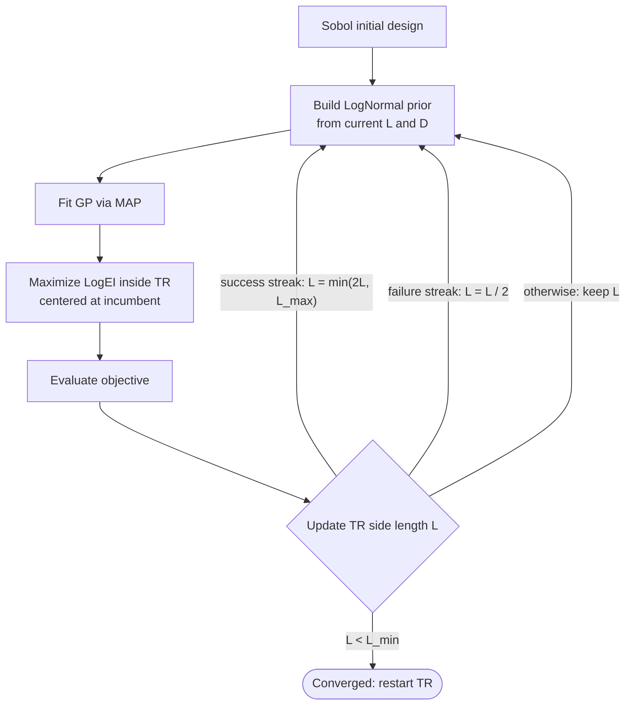

# AdaScale-TuRBO

Code for the paper [Rethinking Trust Region Bayesian Optimization in High Dimensions](https://arxiv.org/abs/2604.22967),
accepted to the 2026 AISTATS OPTIMAL Workshop.

## Method

TuRBO fits a local GP inside a trust region (TR) $[0, L]^D$ around the incumbent. Within such a box, the
typical distance between two points scales as $\Theta(L\sqrt{D})$. If the GP lengthscale does not follow
this scaling, the local model degenerates:

- **Too complex** at large $D$: kernel values vanish, $K \approx I$, and the GP behaves like
  independent noise that learns almost nothing from new samples.
- **Too simple** when the TR shrinks: a lengthscale sized for the whole domain makes the GP overly
  smooth inside a small TR.

AdaScale-TuRBO keeps the kernel geometry fixed by scaling the lengthscale with both the dimension $D$ and
the current TR side length $L$. Each lengthscale gets a LogNormal prior whose location shifts with
$L\sqrt{D}$:

$$
\ell_i \sim \mathcal{LN}\left(\mu_0 + \log\left(L\sqrt{D}\right),\ \sigma_0\right),
\qquad \mu_0 = \sqrt{2},\quad \sigma_0 = \sqrt{3}
$$

With $\ell \propto L\sqrt{D}$, the local GP on $[0, L]^D$ has the same maximum information gain as a
dimension-scaled global GP on $[0, 1]^D$ ([Hvarfner et al., 2024](https://arxiv.org/abs/2402.02229)),
so its complexity stays consistent as the TR grows and shrinks.

Compared with standard TuRBO, only the surrogate fit changes:

| | TuRBO | AdaScale-TuRBO |
|---|---|---|
| Lengthscale prior | Box constraints | LogNormal prior that rescales with $L\sqrt{D}$ |
| Hyperparameter fit | Maximum likelihood (MLE) | Maximum a posteriori (MAP) |
| Signal variance | Learned | Fixed to $\sigma_f^2 = 1$ |

The rest of the TuRBO loop is unchanged. The prior is rebuilt from the current $L$ each time the GP is
refit:



This script stops at the first convergence (or when the budget `n_tot` is used up).

In the code, the prior is built in `get_covar_module_with_dim_scaled_prior`
([`src/gpytorch_modules_new.py`](src/gpytorch_modules_new.py)), and the TR loop lives in
[`src/AdaScale_TuRBO_optimize.py`](src/AdaScale_TuRBO_optimize.py).

## Installation

```sh
pip install -r requirements.txt
```

## Running experiments

Experiments are launched with `main.py`. A benchmark must be specified:

```sh
python main.py benchmark=<benchmark_name>
```

Available benchmarks (see [`configs/benchmark/`](configs/benchmark)):

| Benchmark     | Dim | Domain           | Budget |
|---------------|-----|------------------|--------|
| `rastrigin`   | 50  | `[-5, 5]^d`      | 500    |
| `michalewicz` | 50  | `[0, 3.14]^d`    | 500    |
| `schwefel`    | 50  | `[-500, 500]^d`  | 500    |
| `rover`       | 60  | `[-0.1, 1.1]^d`  | 1000   |

Adding `seed=<number>` is recommended for reproducibility.

### Configuration overrides

Default settings live in [`configs/default.yaml`](configs/default.yaml) and the per-benchmark files.
Since this project uses [Hydra](https://hydra.cc/), any value can be overridden from the command line:

```sh
# Override the evaluation budget for the Rastrigin benchmark
python main.py benchmark=rastrigin seed=0 benchmark.n_tot=1000
```

Hydra's multirun mode sweeps over seeds or benchmarks:

```sh
python main.py -m benchmark=rastrigin,schwefel seed=0,1,2
```

Run outputs and logs are written to `outputs/<timestamp>/`.

## Project structure

```
main.py                          # Hydra entry point
configs/
  default.yaml                   # Global settings (seed, Hydra output dirs)
  benchmark/*.yaml               # Per-benchmark settings
src/
  AdaScale_TuRBO_optimize.py     # Trust-region state, candidate generation, BO loop
  gpytorch_modules_new.py        # Kernel with TR- and dimension-scaled lengthscale prior
  benchmark/                     # Schwefel and rover test functions
```

## Citation

If you use this code in your research, please cite:

```bibtex
@article{tang2026rethinking,
  title={Rethinking Trust Region Bayesian Optimization in High Dimensions},
  author={Tang, Wei-Ting and Paulson, Joel A},
  journal={arXiv preprint arXiv:2604.22967},
  year={2026}
}
```

## License

MIT; see [LICENSE](LICENSE).
